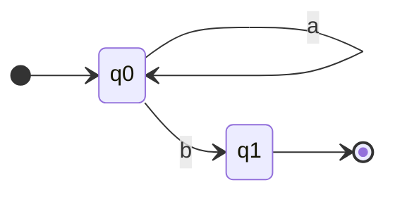
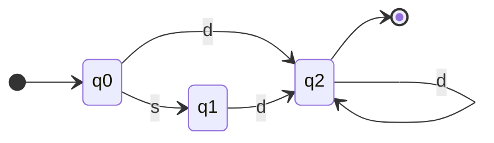

# Autómatas, Visitors de AST, Búsqueda Combinatoria y Mónadas

**EIF400 Paradigmas de Programación · Repaso para el II Parcial (viernes 13/11, 10:00 am)**
Temas: autómatas finitos, visitor recursivo de AST (evaluador, analizador, generador), homoicónico, búsqueda combinatoria (generar y probar), mónadas (modelo de estado, Promise como mónada), comparación generadores / Stream / backtracking.

---

## 0. Aclaraciones del profesor (correo del 12/11 y tutoría)

| | |
|---|---|
| ❌ No entra | dibujar un árbol de prueba |
| ❌ No entra | resolver una ecuación de unificación |
| ❌ No entra (dicho en la tutoría, según un compañero) | Cyphail con updates y MQI |
| ⭐ Énfasis | lazy vs eager, lambdas, clausuras, asincronía vs sincronía (JS) |
| ⭐ Énfasis | ejecución de código "a mano", pila y cola (JS), timers (`setTimeout`, `setInterval`) |
| ⭐ Énfasis | recursión de cola: transformar un algoritmo recursivo de pila en uno de cola |
| ⭐ Énfasis | **mónada como modelo de estado; Promises como mónada** |
| ⭐ Atención | DCG |
| ⭐ Atención | generadores (JS), Stream (Java) y backtracking (Prolog) |

(De correos anteriores: tampoco entran α, η, numerales de Church ni Y. Sí entran β y los combinadores.)

---

## 1. Autómatas finitos

Máquina que lee un texto **símbolo por símbolo** y responde **acepto** o **rechazo**. Solo recuerda **en qué estado está**.

> **Analogía:** un juego de mesa. La ficha está en una casilla (estado); cada letra leída dice por cuál flecha moverse (transición). Si al acabarse el texto la ficha está en una meta (estado final), se acepta.

| Pieza | Qué es |
|---|---|
| Estados | las situaciones posibles: **lo que ya leí** |
| Estado inicial | donde se empieza (uno solo) |
| Estados finales | donde se acepta (uno o más) |
| Alfabeto | los símbolos que puede leer |
| Transiciones | estado + símbolo → nuevo estado |

**Se rechaza de dos formas:** no hay flecha para el símbolo leído, o el texto se acaba en un estado que no es final.
**Cada flecha consume exactamente un símbolo.** No hay flechas de "no leer nada".

### Ejemplo 1: `a*b` (cero o más `a` y luego una `b`)

- `aab`: `q0 —a→ q0 —a→ q0 —b→ q1` → acepta ✅
- `aba`: `q0 —a→ q0 —b→ q1 —a→ ?` sin flecha → rechaza ❌
- `aa`: termina en `q0`, que no es final → rechaza ❌

```prolog
inicial(q0).
final(q1).
delta(q0, a, q0).          % delta(Estado, Símbolo, NuevoEstado)
delta(q0, b, q1).

acepta(Texto) :- inicial(Q), recorre(Q, Texto).

recorre(Q, [])      :- final(Q).                         % se acabó el texto: ¿estoy en un final?
recorre(Q, [C | R]) :- delta(Q, C, Q1), recorre(Q1, R).  % leo C, sigo la flecha, continúo
```
`recorre` es recursiva de cola; el estado `Q` hace de acumulador.

### Ejemplo 2: enteros con signo opcional `[+-]?[0-9]+`
(`s` = un signo, `d` = un dígito)

| Estado | Significa | ¿Final? |
|---|---|---|
| `q0` | no he leído nada | no |
| `q1` | leí el signo, falta al menos un dígito | no |
| `q2` | ya leí al menos un dígito | **sí** |


```prolog
inicial(q0).
final(q2).
delta(q0, s, q1).
delta(q0, d, q2).      % el signo es opcional: atajo directo con un dígito
delta(q1, d, q2).
delta(q2, d, q2).      % bucle: más dígitos
```
- `[s, d, d]`: `q0 → q1 → q2 → q2` → acepta ✅
- `[s]`: termina en `q1` → rechaza ❌
- `[d, s]`: desde `q2` no hay flecha con `s` → rechaza ❌

**¿Dos estados son distintos?** Sí, si reaccionan diferente ante algún símbolo (`q0` acepta un signo; `q1` no: si fueran el mismo se aceptaría `++-5`).
**Lo opcional** se modela con un atajo que consume el símbolo siguiente, no con una flecha vacía.

### Relación con lo demás
| Herramienta | El lenguaje `a*b` |
|---|---|
| Expresión regular | `a*b` |
| Gramática | `S → aS \| b` |
| DCG | `s --> [a], s.` y `s --> [b].` |
| Autómata | el diagrama |

**Limitación:** como solo recuerda el estado, **no puede contar**. No hay autómata finito para `aⁿbⁿ` ni para paréntesis balanceados; para eso se usa una gramática (DCG).

---

## 2. Visitor recursivo de AST

Un **AST** es el árbol que deja el parser. `20 + 30 * x` es el término `num(20) + num(30) * id(x)`:
```
          +
        /   \
   num(20)    *
            /   \
       num(30)  id(x)
```
Un **visitor recursivo** recorre el árbol con **una cláusula por tipo de nodo**:
- **Hojas** (`num`, `id`): responden directo (casos base).
- **Nodos internos** (`+`, `*`): bajan al hijo izquierdo, bajan al derecho y **combinan**.

> **Analogía:** un inspector que recorre un edificio; si un cuarto tiene puertas a otros, entra primero a esos y después junta los reportes.

Prolog escoge la cláusula por **unificación** con la forma del nodo.

**Receta para escribir cualquier visitor:** (1) listar los tipos de nodo; (2) decidir qué devuelve cada hoja; (3) decidir cómo se combinan las respuestas de los hijos.

### Evaluador: "¿cuánto vale?"
```prolog
eval(num(N), _, N).
eval(id(X), M, V) :- get_dict(X, M, V).               % M es la memoria, ej. memory{x: 10}
eval(A + B, M, V) :- eval(A, M, VA), eval(B, M, VB), V is VA + VB.
eval(A * B, M, V) :- eval(A, M, VA), eval(B, M, VB), V is VA * VB.
```
```
eval( 20 + 30*x )                      con x = 10
├─ eval( num(20) )           → 20
├─ eval( num(30) * id(x) )
│  ├─ eval( num(30) )        → 30
│  ├─ eval( id(x) )          → 10
│  └─ V is 30 * 10           → 300
└─ V is 20 + 300             → 320
```
Las respuestas suben desde las hojas. La multiplicación se hace primero porque está **más abajo** en el árbol (el parser la puso ahí por la precedencia).

### Analizador: "¿qué puedo decir del programa sin ejecutarlo?"
No necesita memoria: solo mira la forma del árbol.
```prolog
% Ejemplo 1: contar operaciones
ops(num(_), 0).
ops(id(_), 0).
ops(A + B, N) :- ops(A, NA), ops(B, NB), N is NA + NB + 1.
ops(A * B, N) :- ops(A, NA), ops(B, NB), N is NA + NB + 1.
% ops(num(20) + num(30) * id(x), N)  →  N = 2

% Ejemplo 2: listar las variables usadas
vars(num(_), []).
vars(id(X), [X]).
vars(A + B, L) :- vars(A, LA), vars(B, LB), append(LA, LB, L).
vars(A * B, L) :- vars(A, LA), vars(B, LB), append(LA, LB, L).
% vars(num(20) + num(30) * id(x) + id(y), L)  →  L = [x, y]
```

### Generador de código: "tradúcelo a otro lenguaje"
Devuelve instrucciones para una máquina de pila (`push`/`load` ponen un valor; `add`/`mul` sacan dos, operan y ponen el resultado).
```prolog
gen(num(N), [push(N)]).
gen(id(X), [load(X)]).
gen(A + B, Code) :- gen(A, CA), gen(B, CB), append([CA, CB, [add]], Code).
gen(A * B, Code) :- gen(A, CA), gen(B, CB), append([CA, CB, [mul]], Code).
% gen(num(20) + num(30) * id(x), C)  →  C = [push(20), push(30), load(x), mul, add]
```
Regla: **código del hijo izquierdo, código del derecho, y al final la instrucción del operador.**

| Instrucción (x = 10) | Pila después |
|---|---|
| `push(20)` | `[20]` |
| `push(30)` | `[20, 30]` |
| `load(x)` | `[20, 30, 10]` |
| `mul` | `[20, 300]` |
| `add` | `[320]` |

### Los tres, lado a lado
| | Evaluador | Analizador | Generador |
|---|---|---|---|
| Pregunta | ¿cuánto vale? | ¿qué tiene? | ¿cómo se traduce? |
| `num(20)` devuelve | `20` | `0` / `[]` | `[push(20)]` |
| `A + B` combina con | `is` | suma / `append` | `append` + instrucción |
| ¿Necesita memoria? | sí | no | no |
| ¿Ejecuta? | sí | no | no, traduce |

Ninguno es recursivo de cola: queda trabajo pendiente después de las llamadas y hay dos llamadas por nodo.

---

## 3. Homoicónico

Un lenguaje es **homoicónico** cuando **el código y los datos tienen la misma forma**: un programa es una estructura de datos del propio lenguaje, así que un programa puede leer, construir y ejecutar otros programas.

> **Analogía:** una receta hecha con piezas de LEGO en un mundo donde todo es de LEGO: se desarma, se rearma y se cocina con las mismas manos.

**Prolog es homoicónico:** reglas, metas y datos son todos **términos**.
```prolog
?- T = foo(1, 2), T =.. L.                     % L = [foo, 1, 2]    desarmo "código" como lista
?- G =.. [atom_length, hola, N], call(G).      % N = 4              armo una meta como dato y la ejecuto
?- X = 2 + 3.                                  % X = 2+3            la expresión es un árbol, no un 5
?- assert(doble(X, Y) :- Y is X * 2).          %                    agrego una regla, que es un término
```
Por eso en Prolog el AST sale gratis y por eso una consulta se puede compilar a una **meta de Prolog** (un término) y ejecutarse con `call`.
**JS y Java no lo son:** el código es texto y hay que parsearlo a un AST aparte.

---

## 4. Búsqueda combinatoria: generar y probar

Se describe **qué** es una solución y el backtracking hace la búsqueda.

> **Analogía:** abrir un candado de combinación: **generar** una combinación, **probar** si abre; si no, el backtracking pone la siguiente.

```prolog
solucion(X) :- generar(X), probar(X).
```

| Generadores | Proponen |
|---|---|
| `between(1, 10, X)` | 1, 2, …, 10 |
| `member(X, L)` | cada elemento |
| `select(X, L, Resto)` | un elemento y lo que queda (sin repetir) |
| `permutation(L, P)` | cada reordenamiento |
| hechos (`color(rojo). color(verde).`) | cada hecho |

**Pruebas:** `=:=`, `<`, `\=`, `\+`.

### Ejemplo 1: ternas pitagóricas
```prolog
terna(A, B, C) :-
    between(1, 20, A), between(A, 20, B), between(B, 20, C),
    C * C =:= A * A + B * B.
% A = 3, B = 4, C = 5 ;  A = 5, B = 12, C = 13 ; …
```
Empezar el segundo `between` en `A` evita repetidos y prueba menos candidatos.

### Ejemplo 2: tríos de dígitos distintos que suman 10
```prolog
trio(A, B, C) :-
    between(1, 9, A), between(1, 9, B), A < B,
    between(1, 9, C), B < C,
    A + B + C =:= 10.

?- findall(A-B-C, trio(A, B, C), L).
L = [1-2-7, 1-3-6, 1-4-5, 2-3-5].
```

### Ejemplo 3: colorear un mapa (A–B–C en fila)
```prolog
color(rojo). color(verde).
mapa(A, B, C) :- color(A), color(B), A \= B, color(C), B \= C.
```

**Reglas:**
- **Todas las soluciones:** `findall(Plantilla, Meta, Lista)`.
- **Eficiencia:** cada prueba va **apenas sus variables tengan valor**; así se descartan candidatos sin generar el resto.
- **Nunca probar antes de generar:** `A \= B, color(A), color(B)` falla siempre (dos variables vacías sí unifican), y `<` o `=:=` con variables vacías dan error.

---

## 5. Mónadas

**Problema:** en FP queremos funciones puras, pero hay "situaciones": un valor que puede no existir, que todavía no llega, que puede fallar, o que son muchos. Esa situación es el **estado**.

**Solución:** meter el valor en una **caja que lleva el estado** y encadenar operaciones sin abrirla a mano.

> **Analogía:** una línea de ensamblaje donde las piezas viajan en **cajas con etiqueta** ("vacía", "en camino", "dañada", "lista"). Las estaciones trabajan con la pieza; la caja revisa la etiqueta y, si dice "vacía" o "dañada", se salta la estación.

**Mónada = caja + unit + bind**

| Operación | Qué hace | Nombres |
|---|---|---|
| **unit** | mete un valor en la caja | `Promise.resolve(x)`, `Optional.of(x)`, `Stream.of(x)`, `[x]` |
| **bind** | aplica una función **que devuelve otra caja** y deja **una sola** (aplana) | `.then(f)`, `.flatMap(f)` |

### `map` vs `flatMap`
```javascript
[1, 2, 3].map(x => [x, x])        // [[1, 1], [2, 2], [3, 3]]   caja dentro de caja
[1, 2, 3].flatMap(x => [x, x])    // [1, 1, 2, 2, 3, 3]         aplanado
```
```java
Optional.of(5).map(x -> Optional.of(x + 1))       // Optional[Optional[6]]
Optional.of(5).flatMap(x -> Optional.of(x + 1))   // Optional[6]
```
`map`: la función devuelve un valor normal y la caja lo envuelve. `flatMap`: la función devuelve una caja y se aplana.

### La mónada como modelo de estado
El estado viaja **dentro de la caja** y el **bind lo propaga** por la cadena, sin variables mutables.

| Mónada | Estado que modela | Qué hace el bind |
|---|---|---|
| `Optional` (Java) | hay valor / vacío | si está vacío, se salta lo que sigue |
| `Promise` (JS) | pending / fulfilled / rejected | espera; si se rechaza, se salta hasta el `catch` |
| `Stream`, `Array` | cero, uno o muchos | aplica a cada uno y junta |

```java
Optional.of(usuario)
    .flatMap(u -> u.getDireccion())
    .flatMap(d -> d.getCiudad())
    .map(c -> c.toUpperCase());      // sin un solo if (x != null)
```

### Promise como mónada
| Pieza | En Promise |
|---|---|
| caja | la promesa |
| estado | pending → fulfilled / rejected |
| unit | `Promise.resolve(x)` |
| bind | `.then(f)` |

```javascript
Promise.resolve(2)
    .then(x => Promise.resolve(x + 3))   // devuelve promesa → se aplana: 5
    .then(x => x * 10)                   // devuelve valor → promesa de 50
    .then(console.log)                   // 50
```
Nunca hay "promesa de promesa": `then` hace de `map` y de `flatMap`.

```javascript
Promise.resolve(1)
    .then(x => { throw "ups" })          // pasa a rejected
    .then(x => console.log("A"))         // se salta
    .catch(e => console.log("B", e))     // B ups
    .then(() => console.log("C"))        // C  (el catch devolvió una promesa cumplida)
```
`async/await` es azúcar: cada `await` es un `then` escondido.

---

## 6. Generadores vs Stream vs backtracking

Los tres producen **muchos resultados de a uno, bajo demanda (lazy)**: separan **producir** de **consumir**.

| | Generador (JS) | Stream (Java) | Backtracking (Prolog) |
|---|---|---|---|
| Se define con | `function*` + `yield` | `Stream.of`, `iterate`, `.stream()` | varias cláusulas o hechos |
| Pide el siguiente | `next()` / `for...of` | la operación terminal | `;` / `fail` / `findall` |
| ¿Infinito? | sí (`while (true)`) | sí (`iterate`, cortar con `limit`) | sí (`between(1, inf, X)`) |
| Se pausa | en el `yield` | no corre sin terminal | deja un punto de elección |
| Recoger todo | `[...gen]`, `Array.from` | `.toList()` | `findall` |
| Cortar antes | `break`, `return` | `limit`, `findFirst` | `!`, `once` |

---

## 7. Resumen rápido

| Tema | Recordar |
|---|---|
| Autómata | estado = lo que ya leí; cada flecha consume un símbolo; acepta si termina en final; no puede contar |
| Visitor | una cláusula por tipo de nodo; hojas = casos base; internos = bajar y combinar |
| Evaluador / analizador / generador | valor / información / otro programa |
| Homoicónico | código y datos con la misma forma (Prolog: términos, `=..`, `call`, `assert`) |
| Generar y probar | generador (`between`, `member`) + prueba; probar lo antes posible, nunca antes de generar |
| Mónada | caja + unit + bind; el estado viaja en la caja |
| Promise | unit = `Promise.resolve`, bind = `then`; pending / fulfilled / rejected |
| `map` vs `flatMap` | envuelve vs aplana |

**Errores clásicos:** juntar el estado inicial con "ya leí el signo" · poner una flecha vacía para lo opcional · olvidar que terminar en un estado no final rechaza · probar antes de generar · creer que el `then` después de un `catch` no corre · confundir `map` con `flatMap`.
